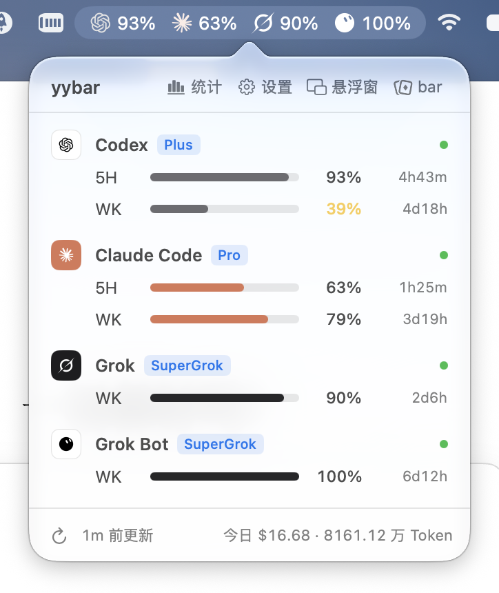
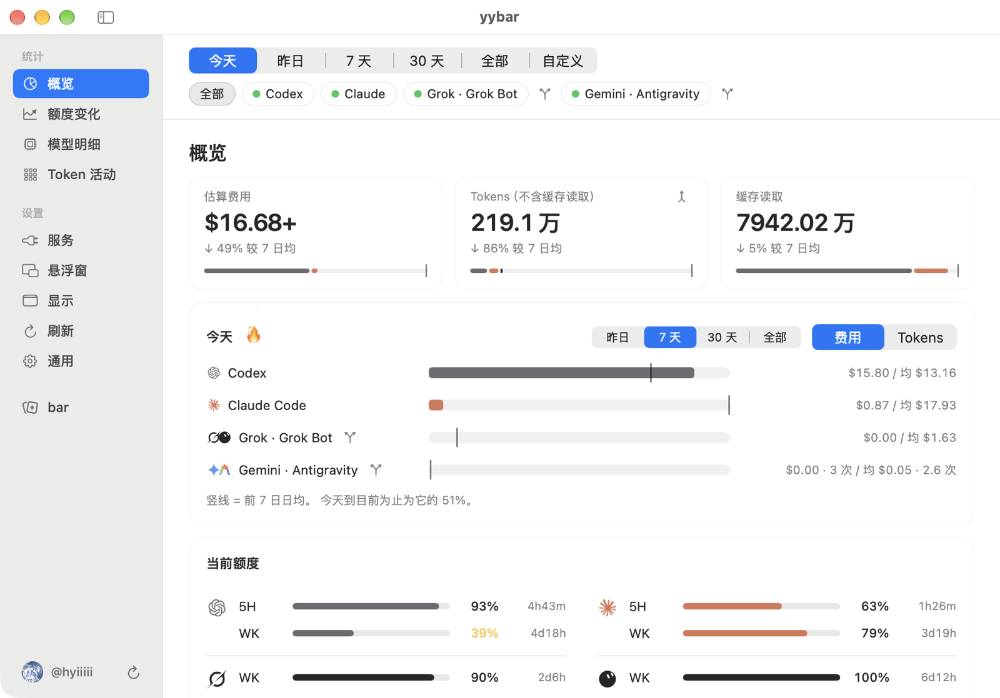
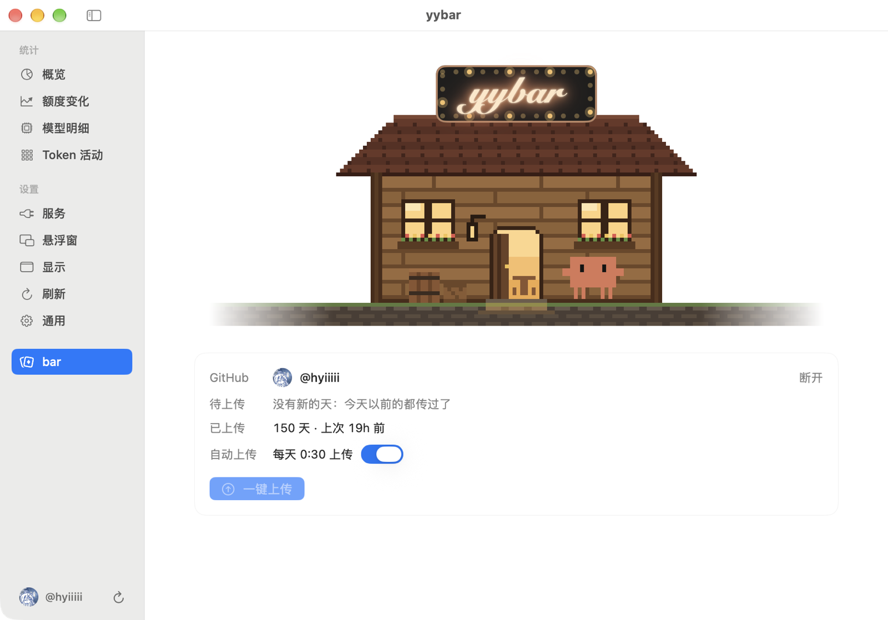

<p align="center">
  
</p>

<h1 align="center">yybar</h1>

<p align="center">
  在菜单栏上看 Codex、Claude Code、Grok、Gemini 还剩多少额度，本机用了多少 Token、花了多少钱
</p>

<p align="center">
  
  
  
  
</p>

<p align="center">中文 · <a href="#english">English</a></p>

<p align="center">
  
</p>

yybar 是一个 macOS 菜单栏小工具，在 [nanvon/cc-bar](https://github.com/nanvon/cc-bar) 的基础上改的。它把 Codex、Claude Code、Grok 这些 AI 编码工具的剩余额度放在菜单栏上，顺便统计本机用了多少 Token、大概花了多少钱。每天的用量还可以传到 yybar 网站换筹码，拿去打德州。

也有 Windows 版，代码在 [`windows/`](windows/)，功能跟 Mac 版基本一致，差别见 [docs/Windows版.md](docs/Windows版.md#5-和-mac-版的差别)。

## 支持的服务

| 服务 | 额度 | 本机用量 | 登录从哪来 |
|---|---|---|---|
| Codex | 5 小时 / 每周 | 有 | `codex login` |
| Claude Code | 5 小时 / 每周 | 有，含桌面 App 的 Cowork 会话 | `claude` |
| Grok | 当前计费周期 | 有 | `grok login` |
| Grok Bot | 每周 | 有 | Grok Bot 桌面 App（仅 Mac） |
| Gemini App | 5 小时 / 每周 | 只有回答次数 | Chrome 当前的 Google 账号（仅 Mac） |
| Antigravity（agy） | Gemini 池和 Claude·GPT 池，各有 5 小时 / 每周 | 有 | 本机 agy CLI |

## 功能

### 菜单栏

每个服务在菜单栏上占一个图标，旁边是剩余百分比，可以选看 5 小时额度、每周额度，或者两个都看。Windows 上是每个服务一个托盘图标。

哪个 CLI 正在干活，它的图标就会一明一暗地呼吸（上面的动图）。CLI 停下来等你批准工具调用时，图标常亮不闪，不用切回终端也知道该去点一下了。默认靠读日志判断，Mac 上也可以给 Codex、Claude Code、Grok、agy 装 yybar 的 hook，反应更快；hook 只加自己的那几条，关掉时也只删自己的。

### 额度弹出窗口

<p align="center">
  
</p>

点菜单栏图标弹出。每个账号一块：套餐、5 小时和每周额度各剩多少、多久后重置，右上角的圆点是这家服务官方状态页的状态。某个账号刷新失败时，名字旁边会有个小警告，鼠标放上去看原因。底部是今天的花费和 Token。

顶上四个按钮：统计、设置、悬浮窗（直接切换悬浮窗样式）、bar（在浏览器打开 yybar 网站）。

### 桌面悬浮窗

<p align="center">
  
</p>

一个始终在最上层的小窗口，不抢焦点。有三种样式：

- 简略：每个账号一条进度条加百分比（默认）
- 详细：每个账号的 5H / WK 和重置时间
- 隐藏：关掉悬浮窗

可以随便拖，位置会记住。拖到屏幕左右边缘会收成一条窄条，只留图标和百分比；点一下滑出来，或者像拉抽屉一样拖出来。右键可以切样式、开统计和设置。显示哪些账号在「设置 › 服务」里勾。

### 统计

<p align="center">
  
</p>

数据全部来自本机 CLI 的会话日志，只读 Token 数、模型和时间，不读对话内容。

- 概览：费用、Token、缓存读取，每日用量柱图，今天和昨天 / 近 7 天 / 近 30 天平均的对比
- 额度变化：今天各账号额度的变化曲线
- 模型明细：每个模型的输入、输出、缓存和费用
- Token 活动：最近 53 周的热力图和连续使用天数
- 模型价格：内置官方价，可以自己改，改完历史费用会重算

时间范围可选今天、昨日、7 天、30 天、全部或自定义，也可以只看某一家。Codex 压缩过的旧会话（`.jsonl.zst`）和额外的 `CODEX_HOME` 目录也会统计；Windows 版可以把 WSL 里的用量一起算上。

### 多账号

yybar 会自动认出本机 CLI 登录的账号。想看别的账号，可以在设置里添加：走一遍官方 CLI 的浏览器登录（用独立目录，不动本机登录），或者直接粘贴凭据，cc-switch 导出的多账号 JSON 也认。

添加之后可以一键把本机 CLI 切到另一个账号，原来的账号会留着，随时能切回去。每个账号会显示套餐和下次续费日，快续费时有提醒；要不要出现在菜单栏和悬浮窗里，每个账号单独勾。

### 刷新

额度默认每 2 分钟刷新一次，1 到 10 分钟可调。被限流（429）后会停 10 分钟再试，手动刷新也不会绕过去。网络不通时保留上一次的数据，不会清空。登录快过期时自动续期，续不上就提示重新登录。

### bar 和 yybar 网站

主窗口侧边栏的 bar 通向 [yybar 网站](https://yybar-web.hyi030618.workers.dev)。用 GitHub 连接后，可以把已经过完的每一天的用量传上去，花费 $1 换 1 个筹码。每天能手动传一次，也可以打开每天 0:30 自动上传。

网站上有 Token 燃烧榜和财富榜、多人德州扑克（人不够有机器人桌）、用筹码换牌背和道具的商场，还有一些成就。

<p align="center">
  
</p>

这部分完全可选，不连 GitHub 就什么都不会上传。

### 其他

- 界面有中文和英文，字体大小可调，可以开机自动启动
- 第一次启动有引导，列出认到的账号，让你勾选显示在哪
- 快捷键：统计 ⌘1，设置 ⌘,，刷新 ⌘R，隐藏侧边栏 ⌃⌘S
- Mac 上后台常驻大约占 25 MB 内存，CPU 约 0.1%

## 安装

### macOS

暂未提供签名公证过的安装包，需要从源码构建。

要求：

- macOS 14 Sonoma 或更新版本，Xcode 26 或更新版本
- 已在终端登录过要看的 CLI：`codex login`、`claude`、`grok login`
- 可选：`brew install zstd`（统计 Codex 压缩过的旧会话需要）

```bash
git clone https://github.com/hyiiiii/yybar.git
cd yybar
scripts/make_signing_cert.sh    # 只需一次：在登录钥匙串里创建本机自签代码签名证书
scripts/build_and_install.sh    # 构建 Release 并安装到 /Applications/yybar.app
```

固定的自签证书让每次构建的签名身份保持一致；不创建证书也能安装，脚本会改用 ad-hoc 签名。以后更新时 `git pull` 后再运行一次 `scripts/build_and_install.sh` 即可，设置和统计数据不受影响。

### Windows

在仓库的 Actions →「Windows 客户端」里打开最近一次成功的运行，下载 `yybar-windows-installer`，解压后运行 `yybar_x.y.z_x64-setup.exe`（装到当前用户，不需要管理员权限）。安装包没有代码签名，第一次运行时 SmartScreen 会拦截，点「更多信息 → 仍要运行」。需要 WebView2（Windows 11 自带）。从源码构建见 [windows/README.md](windows/README.md)。

首次启动会弹出引导窗口，列出识别到的账号并做几项基本设置。

## 常见问题

**Claude Code 显示小警告，提示登录已失效？**
Claude Code 的登录过期后会清空本机保存的令牌。在终端运行 `claude`，按提示输入 `/login` 重新登录，回到 yybar 点刷新即可。

**统计里少了 Codex 的旧会话？**
Codex 会把旧会话压缩成 `.jsonl.zst`，Mac 上需要本机有 `zstd` 命令（`brew install zstd`），装好后下一次扫描会自动补上。

**模型显示「未定价」，费用是「—」？**
新模型还没有内置价格。到 设置 · 通用 · 模型价格 填写，历史费用会按新价格重算。

**Antigravity 提示「agy 未登录或登录刷新失败」？**
多半是当时网络或代理不通，agy 没能续上登录，网络恢复后会自己好。一直不好的话，在终端运行 `agy` 重新登录一次。yybar 查额度时不会再替 agy 弹出浏览器登录页。

**切换账号后 CLI 还在用旧账号？**
已经在运行的 CLI 会话需要重启才会使用新账号。

**Codex / Grok 的缓存写入为什么是「—」？**
这两家的日志不单独记录缓存写入，无法统计，不是漏算。

**Windows 上上传失败，提示连接超时？**
yybar 网站在 Cloudflare Workers 上，部分网络需要代理。在代理软件中开启「系统代理」或 TUN / 全局模式后重试即可，yybar 会自动使用新的代理设置，不用重开。

**Grok Bot / Gemini App 如何显示额度？**
Grok Bot 需要已登录桌面 App。Gemini 需要 Chrome 当前个人资料登录与 Gemini App 相同的 Google 账号，并能打开 gemini.google.com。首次可能需要在 macOS 钥匙串窗口允许 yybar 读取对应的 Safe Storage 条目。两项都不发送推理请求。Gemini 额外读取近期会话的回答次数和模型名，不保存正文或会话 ID，没有 token / 费用明细。Google 要求网页验证时保留上次额度并暂停请求 10 分钟。

**额度在掉，统计里却没有对应的用量？**
本机 CLI 和 Claude 桌面 App 的 Cowork 会话从日志统计；Claude 桌面端的「项目」可在 设置 · 刷新 · Claude 云端项目 开启同步。普通 claude.ai 网页 / App 对话没有可读取的用量数据，暂不支持。

## 数据与隐私

- 本地用量只读会话日志里的 token 数、模型和时间，不读对话内容：`~/.codex/sessions`、`~/.codex/archived_sessions`、`~/.claude/projects`（以及 Claude 桌面 App Cowork 会话的日志）、`~/.grok/sessions`、agy 的会话库。
- Gemini App 只读取 Chrome 的 Google 会话 Cookie（`__Secure-1PSID` / `__Secure-1PSIDTS`）；解密密钥与 Cookie 仅驻留内存，仅发送至 `https://gemini.google.com`。不读取其他网站数据。
- 网络请求只发往各服务自己的接口（查询额度、云端用量与近期模型元数据、续期登录）和官方状态页。
- **yybar 网站是可选的**：只有用 GitHub 连接后才会上传，自动上传默认关闭。上传的是按「天 × 服务 × 模型」汇总的 token 数和花费，以及各账号的套餐（账号只传摘要，不传邮箱）；不含对话内容和任何密钥。网站上的令牌可在「我的」页撤销，App 里「断开」删除本机令牌。
- 本地数据位置：
  - Mac：`~/Library/Application Support/yybar/`（额度缓存、用量汇总、其他账号的 token，只有本用户可读）、`~/Library/Caches/yybar/`（日志扫描进度）
  - Windows：`%APPDATA%\yybar\`（设置、缓存、用量汇总、其他账号凭据）、`%LOCALAPPDATA%\yybar\`（日志扫描进度）
- 卸载：Mac 删除 `/Applications/yybar.app` 和上面两个目录；Windows 在「设置 → 应用」里卸载，再删除上面两个目录。

## 开发

Mac：用 Xcode 打开 `yybar.xcodeproj`，scheme 选 `yybar` 运行。

| 目录 | 内容 |
|---|---|
| `MenuBar/` | 菜单栏图标、额度弹出窗口 |
| `Main/` | 主窗口：统计、设置、bar |
| `Floating/` | 桌面悬浮窗 |
| `Settings/` | 设置页、添加账号、模型价格 |
| `Onboarding/` | 首次启动引导 |
| `Core/` | 凭据、额度请求、刷新调度、日志扫描、本地存储、网站上传 |
| `Tests/` | 日志扫描回归测试 |
| `scripts/` | 构建安装、签名证书、生成 App 图标 |
| `windows/` | Windows 版（Tauri 2：Rust 后台 + React 界面），见 [windows/README.md](windows/README.md) |
| `web/` | yybar 网站：GitHub 登录、用量上传、排行榜、德州、商场、成就（Cloudflare Workers + D1），见 [web/README.md](web/README.md) |

产品需求、技术实现、设计风格、界面布局等文档见 [docs/](docs/README.md)。

## 致谢

- [cc-bar](https://github.com/nanvon/cc-bar) —— yybar 的起点
- [cc-switch](https://github.com/farion1231/cc-switch) —— 多 Provider 账号切换器，启发了多账号管理与导入流程
- [cockpit-tools](https://github.com/jlcodes99/cockpit-tools) —— 多平台 AI 编码助手仪表盘，在额度与刷新策略上提供了参考
- [CodexBar](https://github.com/steipete/CodexBar) —— macOS 菜单栏 AI 用量监控，在菜单栏交互与本地解析思路上多有借鉴
- [TokenYou](https://github.com/diegoparras/tokenyou) / [Gemini-API](https://github.com/HanaokaYuzu/Gemini-API) —— Gemini Apps 网页额度协议参考

## 许可

[MIT](LICENSE)。Claude / Anthropic、Codex / ChatGPT / OpenAI、Grok / xAI、Gemini / Antigravity / Google、Cursor 是各自所有者的商标，yybar 与这些公司没有关联。

---

<a id="english"></a>

## English

yybar is a menu bar app for macOS (with a Windows version in [`windows/`](windows/)) that shows how much quota you have left on **Codex**, **Claude Code**, **Grok**, **Grok Bot**, **Gemini** and **Antigravity**, plus how many tokens you've used locally and what they cost.

- **Menu bar / taskbar**: each service's logo with its remaining 5-hour / weekly quota. An icon breathes in its own colour while that CLI is working and stays lit while it waits for your approval (optionally driven by CLI hooks on macOS).
- **Quota popup**: click the icon for every account's 5H / WK bars, reset countdowns, plan, service status and today's cost. Buttons at the top open Stats, Settings, a floating-window style picker, and the yybar website.
- **Floating HUD**: always on top without stealing focus; Compact, Detailed or Hidden. Drag it to a screen edge to tuck it into a slim strip, then click or pull it back out like a drawer.
- **Stats**: cost, tokens and cache reads by day, service and model; today vs. recent averages; today's quota changes; a 53-week token heatmap; editable model prices with history recalculation. Everything is read from local CLI session logs, including Codex's compressed `.jsonl.zst` sessions and extra `CODEX_HOME` folders.
- **Accounts**: detects your local CLI logins, adds extra accounts (browser sign-in or pasted credentials), shows plans and renewal dates, and switches the local CLI to another account in one click.
- **bar & website** (optional): connect with GitHub to upload daily per-model usage totals to the [yybar website](https://yybar-web.hyi030618.workers.dev) and turn spending into chips ($1 = 1 chip) for leaderboards, multiplayer Texas hold'em, a shop and achievements.
- Chinese / English UI, adjustable text size, launch at login, first-run onboarding. About 25 MB of memory and 0.1% CPU in the background on macOS.

**macOS — build from source** (macOS 14+, Xcode 26+; optional `brew install zstd`):

```bash
git clone https://github.com/hyiiiii/yybar.git
cd yybar
scripts/make_signing_cert.sh    # once: creates a local self-signed code signing certificate
scripts/build_and_install.sh    # builds Release and installs /Applications/yybar.app
```

**Windows**: download `yybar-windows-installer` from the latest successful "Windows 客户端" run under Actions and run the setup (per-user, no admin rights; unsigned, so SmartScreen asks once). See [windows/README.md](windows/README.md) to build it yourself.

**Privacy**: yybar reads only token counts, models and timestamps from local logs, never conversation content. It talks to each service's own quota and token-refresh endpoints and their status pages. Nothing is uploaded unless you connect the yybar website; then only daily usage totals and account plans (accounts as hashes, no emails) are sent, and auto upload is off by default.

Licensed under [MIT](LICENSE). Claude / Anthropic, Codex / ChatGPT / OpenAI, Grok / xAI, Gemini / Antigravity / Google and Cursor are trademarks of their respective owners; yybar is not affiliated with them.
