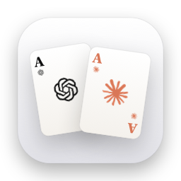

<p align="center">
  
</p>

<h1 align="center">yybar</h1>

<p align="center">
  <b>一眼看清 Codex、Claude Code、Grok 还剩多少额度，本机用了多少 Token、花了多少钱。</b>
</p>

<p align="center">
  
  
  
</p>

<p align="center">中文 · <a href="#english">English</a></p>

yybar 是一个常驻 macOS 菜单栏的小工具(不占 Dock),基于 [nanvon/cc-bar](https://github.com/nanvon/cc-bar) 二次开发。

## 功能

### 菜单栏

- 按 Codex → Claude → Grok 显示剩余额度百分比，可选 5 小时窗口、周窗口或两者都显示
- 哪个 CLI 正在干活，哪个图标就呼吸;在等你审批时保持高亮，不用切到终端也知道谁在等你
- 左键打开统计，右键：打开统计 / 设置 / 立即刷新 / 退出

### 额度

- 5 小时与周窗口的剩余额度和重置时间;Grok 显示云端当前计费周期
- Grok Bot 读取桌面 App 当前账号的周额度；Gemini App 复用 Chrome 当前 Google 账号读取 App 额度；Antigravity 的两个池子独立展示
- 默认每 2 分钟刷新(1–10 分钟可调);同一服务至少间隔 60 秒，遇到限流(429)自动退避 10 分钟
- 网络失败时保留上次的数据;登录快过期时自动续期
- 显示三家官方状态页的当前状态

### 统计

- 时间范围：今天 / 昨日 / 7 天 / 30 天 / 全部 / 自定义，可按服务筛选
- **概览**:估算费用、Token、缓存读取，以及环比;每日用量图;按服务占比;「今天」可对比昨日 / 7 日均 / 30 日均，今天用得越多，标题旁的火苗烧得越旺
- **额度变化**:今天各账号剩余额度的变化曲线和变动记录
- **模型明细**:按模型列出输入 / 输出 / 缓存 / 费用，可排序
- **Token 活动**:最近 53 周的热力图，累计总量、单日峰值、连续使用天数
- 模型价格可自己填写或覆盖，改完后历史费用按新价格重算
- 数据来自本机 CLI 会话日志，包括 Codex 压缩过的旧会话(`.jsonl.zst`)

### 多账号

- 自动识别本机 `codex` / `claude` / `grok` 的登录
- 添加其他账号：在浏览器中登录(调用官方 CLI,使用独立目录，不影响本机登录)或粘贴凭据
- 一键把本机 CLI 切换到另一个账号，原账号自动保留，随时切回
- 每个账号显示订阅档次和下次续费日,3 天内续费橙色提醒
- 其他账号也可以显示在菜单栏和悬浮窗

### 悬浮窗

- 可选的桌面 HUD:可拖动、贴边吸附、始终置顶、不抢焦点

### 其他

- 中英双语、开机自动启动
- 省资源：后台常驻约 25 MB 内存、CPU 约 0.1%;动画交给系统图层播放

## 安装

暂未提供签名公证过的安装包，需要从源码构建。

要求:

- macOS 14 Sonoma 或更新版本,Xcode 26 或更新版本
- 已在终端登录过要看的 CLI:`codex login`、`claude`、`grok login`
- 可选:`brew install zstd`(统计 Codex 压缩过的旧会话需要)

```bash
git clone https://github.com/hyiiiii/yybar.git
cd yybar
scripts/make_signing_cert.sh    # 只需一次：在登录钥匙串里创建本机自签代码签名证书
scripts/build_and_install.sh    # 构建 Release 并安装到 /Applications/yybar.app
```

固定的自签证书让每次构建的签名身份保持一致;不创建证书也能安装，脚本会改用 ad-hoc 签名。以后更新时 `git pull` 后再运行一次 `scripts/build_and_install.sh` 即可，设置和统计数据不受影响。

首次启动会弹出引导窗口，列出识别到的账号并做几项基本设置。

## 常见问题

**统计里少了 Codex 的旧会话?**
Codex 会把旧会话压缩成 `.jsonl.zst`,需要本机有 `zstd` 命令(`brew install zstd`),装好后下一次扫描会自动补上。

**模型显示「未定价」，费用是「—」?**
新模型还没有内置价格。到 设置 · 通用 · 模型价格 填写，历史费用会按新价格重算。

**切换账号后 CLI 还在用旧账号?**
已经在运行的 CLI 会话需要重启才会使用新账号。

**Codex / Grok 的缓存写入为什么是「—」?**
这两家的日志不单独记录缓存写入，无法统计，不是漏算。

**Grok Bot / Gemini App 如何显示额度？**
Grok Bot 需要已登录桌面 App。Gemini 需要 Chrome 当前个人资料登录与 Gemini App 相同的 Google 账号，并能打开 gemini.google.com。首次可能需要在 macOS 钥匙串窗口允许 yybar 读取对应 Safe Storage 条目。两项不发送推理请求。Gemini 额外读取最多 3 个近期会话各 2 轮回答的模型字段，显示「近期会话：Argon」等名称；只保存模型名、采样数量和更新时间，不保存正文或会话 ID，暂无 token / 费用明细。Google 网页验证与登录过期分别提示；验证期间保留上次额度并暂停请求 10 分钟。Grok Bot 可读取按天、模型分类的总 token；接口未返回的模型成本显示「—」，不能由总 token 或额度比例推算。

**额度在掉，统计里却没有对应的用量?**
本机 CLI 和 Claude 桌面 App 的 Cowork 会话从日志统计。Claude 桌面端「项目（测试）」可在「设置 → 刷新 → Claude 云端项目」开启同步，复用本机 Claude Code 登录，首次回补昨天起的记录。普通网页 / App 对话仍未接入。云端按每轮结束日期归档，跨午夜任务计入结束当天；与本机重复的消息会扣除，关闭同步保留历史。

## 数据与隐私

- 本地用量读取日志:`~/.codex/sessions`、`~/.codex/archived_sessions`、`~/.claude/projects`(以及 Claude 桌面 App Cowork 会话的日志)、`~/.grok/sessions`。Claude 云端 Projects 可额外开启同步；普通网页对话未接入。
- Gemini App 只读取 Chrome 的 Google 会话 Cookie（`__Secure-1PSID` / `__Secure-1PSIDTS`）；解密密钥与 Cookie 仅驻留内存，仅发送至 `https://gemini.google.com`。不读取其他网站数据。
- 网络请求只发往各服务自己的接口(查询额度、云端用量与近期模型元数据、续期登录)和官方状态页，没有任何统计或上报。
- 本地数据位置：
  - `~/Library/Application Support/yybar/`:额度缓存、用量汇总、其他账号的 token(`account-tokens/`,只有本用户可读)
  - `~/Library/Caches/yybar/`:日志扫描进度
- 卸载：删除 `/Applications/yybar.app` 和上面两个目录。

## 开发

用 Xcode 打开 `yybar.xcodeproj`,scheme 选 `yybar` 运行。

| 目录 | 内容 |
|---|---|
| `MenuBar/` | 菜单栏图标、额度卡片 |
| `Main/` | 主窗口：统计与设置 |
| `Floating/` | 桌面悬浮窗 |
| `Settings/` | 设置页、添加账号、模型价格 |
| `Onboarding/` | 首次启动引导 |
| `Core/` | 凭据、额度请求、刷新调度、日志扫描、本地存储 |
| `Tests/` | 日志扫描回归测试 |
| `scripts/` | 构建安装、签名证书、生成 App 图标 |

产品需求、技术实现、设计风格、界面布局等文档见 [docs/](docs/README.md)。

## 致谢

- [cc-switch](https://github.com/farion1231/cc-switch) —— 多 Provider 账号切换器，启发了多账号管理与导入流程
- [cockpit-tools](https://github.com/jlcodes99/cockpit-tools) —— 多平台 AI 编码助手仪表盘，在额度与刷新策略上提供了参考
- [CodexBar](https://github.com/steipete/CodexBar) —— macOS 菜单栏 AI 用量监控，在菜单栏交互与本地解析思路上多有借鉴

- [TokenYou](https://github.com/diegoparras/tokenyou) / [Gemini-API](https://github.com/HanaokaYuzu/Gemini-API) —— Gemini Apps 网页额度协议参考

## 许可

[MIT](LICENSE)。Claude、Codex / ChatGPT / OpenAI、Grok / xAI 是各自所有者的商标,yybar 与这些公司没有关联。

---

<a id="english"></a>

## English

yybar is a native macOS menu bar app that shows how much quota you have left on **Codex**, **Claude Code** and **Grok**, and how many tokens you've used locally and what they cost.

- **Menu bar**: remaining 5-hour / weekly quota per service; an icon breathes while that CLI is working and stays lit while it waits for your approval.
- **Stats**: cost, tokens and cache reads by day, service and model; a 53-week token heatmap; editable model prices with history recalculation. Reads local CLI session logs, including Codex's compressed `.jsonl.zst` sessions.
- **Accounts**: detects your local `codex` / `claude` / `grok` logins, adds extra accounts, and switches the local CLI to another account in one click.
- **Floating HUD**, Chinese / English UI, launch at login. About 25 MB of memory and 0.1% CPU in the background.

**Build from source** (macOS 14+, Xcode 26+; optional `brew install zstd`):

```bash
git clone https://github.com/hyiiiii/yybar.git
cd yybar
scripts/make_signing_cert.sh    # once: creates a local self-signed code signing certificate
scripts/build_and_install.sh    # builds Release and installs /Applications/yybar.app
```

Usage data never leaves your Mac. The app only talks to each service's own quota and token-refresh endpoints and their status pages.

Licensed under [MIT](LICENSE). Claude, Codex / ChatGPT / OpenAI and Grok / xAI are trademarks of their respective owners; yybar is not affiliated with them.
